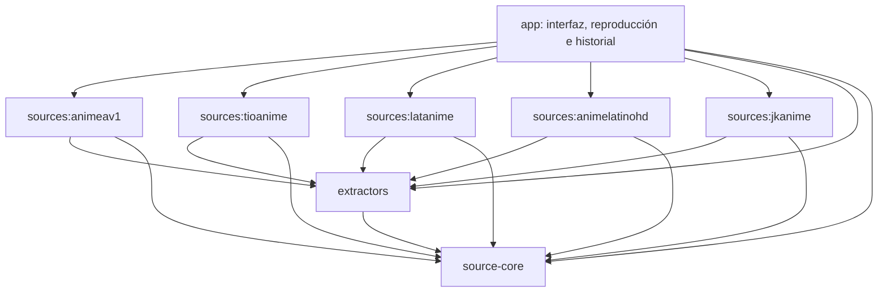

# Módulos internos de AnimeTV

La aplicación se distribuye como un único APK. No hay carga de APK de terceros ni gestor de extensiones instalables.

| Módulo | Responsabilidad |
|---|---|
| `app` | Activities, TV UI, preferencias, favoritos, Seguir viendo, reproducción, búfer, compatibilidad de vídeo, caché de imágenes y sugerencias |
| `source-core` | Contrato `Models.Source`, modelos, HTTP común, cachés de consultas, parsers, filtros y utilidades de audio/texto/orden de servidores |
| `extractors` | Entrada pública `StreamExtractors.resolve`; protocolos compartidos de Voe, MP4Upload, Byse, Mega, YourUpload, Zilla/HLS, Lulu, Filemoon, Mixdrop, Streamwish y las variantes existentes |
| `sources:animeav1` | Catálogo, ficha, episodios y referencias de servidores de AnimeAV1 |
| `sources:tioanime` | Adaptador de Tioanime |
| `sources:latanime` | Adaptador de Latanime y agrupación de doblajes |
| `sources:animelatinohd` | Adaptador de AnimeLatinoHD; solicita páginas protegidas a la app mediante `SourcePageAccess` |
| `sources:jkanime` | Adaptador de JKAnime |

Cada fuente depende únicamente de `source-core` y `extractors`; los módulos inferiores no dependen de la app ni de otra fuente. Gradle compila cada módulo por separado. Se mantiene el paquete Java existente para reducir el riesgo de esta migración; los módulos tienen namespaces de recursos distintos.

## Contratos

- `Models.Source.API_VERSION = 1`: frontera inicial del contrato interno.
- `domains()` y `defaultServers()`: metadatos declarados por cada fuente, sin consultas de red.
- `supportsPreload()`: capacidad de precarga; reemplaza comprobaciones de clases concretas en la interfaz.
- `SourceNetwork.HTTP`: conserva el cliente, DNS y tiempos de espera anteriores, sin depender de AnimeAV1.
- `SourcePageAccess.Host`: la app conserva el navegador, cookies, puntero y verificación manual. El módulo AnimeLatinoHD recibe HTML mediante este contrato.
- `StreamExtractors`: un único punto compartido para resolver servidores; los referers, idioma y cachés de las fuentes se conservan.

Los identificadores, URLs, clases y claves de Store se mantienen. No se migran ni borran favoritos, progreso, categorías o servidor preferido. Las estrellas siguen retiradas; cualquier futura puntuación sería una función de la app, no de las extensiones.

## Distribución

Esta separación permite trabajar en una fuente sin modificar el reproductor. Las cinco fuentes vienen incluidas y listas para usar al instalar AnimeTV. Actualizar una biblioteca empaquetada requiere actualizar el APK. Por decisión del proyecto, no se implementará ahora un gestor de extensiones instalables ni carga de código remoto.

## Verificación

Desde la raíz del proyecto: `gradle testDebugUnitTest lintRelease`. Las pruebas de comportamiento existentes se conservan en `app/src/test` para verificar también la integración entre módulos. Los fixtures continúan allí. No se generan APK adicionales al verificar.
